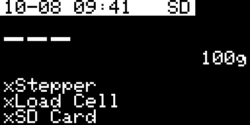
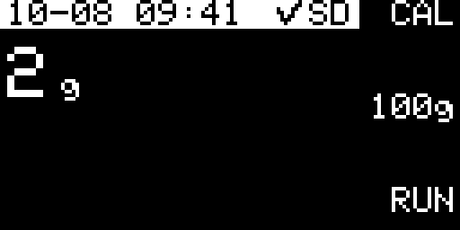
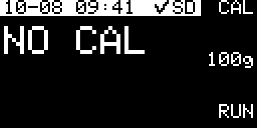
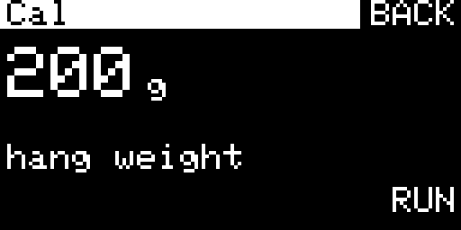
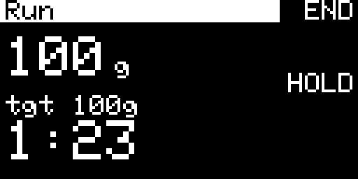
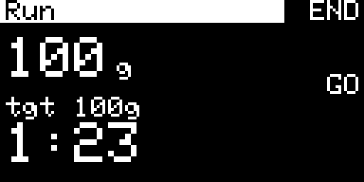
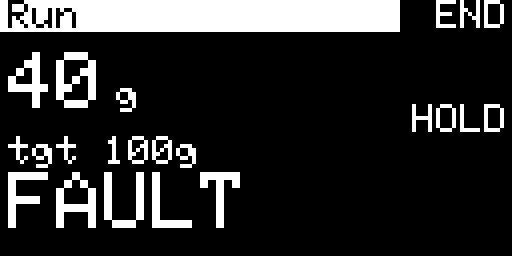

# TRUSS

TRUSS holds a cable at a steady tension. A load cell sits inline with the cable, and a stepper motor winds or unwinds a spool to keep the measured load at the target you set (for example, partially unloading a rodent's body weight).

## What you need

- StepScreen board (Feather M0 Adalogger or compatible) with the OLED and encoder module
- TMC2209 stepper driver, stepper motor with a cable spool, and 12 V motor power
- HX711 load cell amplifier and a load cell inline with the cable
- microSD card (stores the calibration and session logs)

Wire the HX711 to the board's SWD pads:

| HX711 | Board |
|---|---|
| SCK | CLK (SWCLK) |
| DT | DIO (SWDIO) |
| VCC | 3.3 V |
| GND | GND |

### Set the HX711 to 80 Hz

Many HX711 modules ship set to 10 samples per second. That is too slow for this controller and makes the load oscillate. Check the **RATE** jumper on the module and move the solder blob from the 10 Hz pad to the **80 Hz** pad.

## Using TRUSS

The three buttons on the right of the screen are labeled per screen: top (**Back**), middle (**encoder push**), and bottom (**Confirm**).

### Startup

After the splash screen, TRUSS checks the stepper (12 V power), load cell, and SD card. If something is missing, an error screen lists it; press any button to continue. Home will keep listing anything still offline, and the **CAL** and **RUN** buttons only appear once their hardware is ready.

| Startup warning | Home with hardware missing |
|---|---|
|  |  |

### Home

| Ready | Not calibrated yet |
|---|---|
|  |  |

- The big number is the live load in grams (`NO CAL` until the load cell is calibrated).
- Turn the encoder to set the **target load** (0–500 g, default 100 g). The target is shown on the middle button.
- The top bar shows the date and time, plus `✓SD` when the card is ready.
- **CAL** (top button) opens calibration. **RUN** (bottom button) starts a session.

### Calibrate (once per load cell setup)

1. Remove all weight from the cable and press **RUN** to tare (zero) the load cell.
2. Hang a known weight, turn the encoder to enter its mass (50–500 g), and press **RUN**.
3. `SAVED` flashes. The calibration is stored on the SD card (`/TRUSS.CAL`) and loads automatically next time.

| 1. Tare | 2. Known weight | 3. Saved |
|---|---|---|
|  |  |  |

Press **BACK** to return Home. Recalibrate if you change the load cell, cable path, or spool.

### Run a session

1. Attach the load and set the target on Home.
2. Press **RUN**. The motor winds or unwinds until the load reaches the target, then holds it.
3. The Run screen shows the live load, the target (`tgt`), and the elapsed session time.

During a session:

- **Turn the encoder** to change the target on the fly.
- **HOLD** (middle button) pauses the motor and the timer. Press **GO** to resume.
- **END** (top button) stops the motor and returns Home.

| Running | On hold |
|---|---|
|  |  |

### Status lights

| Light | Meaning |
|---|---|
| Green on | Session running |
| Red blinking | Session on hold, or stopped by a fault (check the screen) |
| Both off | Home or Cal screen |

## Faults

If something goes wrong, the motor stops, `FAULT` flashes on the Run screen, and the session log is closed. Press **END** to return Home. Faults are:

- **Overload**: the load went above 800 g.
- **Direction timeout**: the load stayed far from target for 5 s while the motor kept turning one way without making progress. Usually a slack or slipped cable, a disconnected load, a bad calibration, or the motor winding the wrong way.
- **Step limit**: the motor took an unusually large number of steps without the load ever getting close to target (a runaway).

The direction-timeout and step-limit checks restart whenever the load gets back near target, so normal disturbances (an animal lifting off and landing) do not trip a fault.

## Session logs

Each session writes a CSV file to the SD card, organized by date: `/YYYYMMDD/HHMMSS.CSV` (for example, `/20261008/094100.CSV`). Columns:

| Column | Contents |
|---|---|
| `datetime` | Date and time of the row |
| `event` | `begin`, `measure` (about once per second), `end`, or `fault` |
| `target_load_g` | Target load in grams |
| `actual_load_g` | Measured load in grams |

Rows are buffered in memory and written about every 2 minutes and when the session ends. While writing, the motor briefly holds position (it stays engaged, so tension is kept).

The date and time come from the board's real-time clock. Uploading the sketch sets the clock from your computer if the board's clock is unset or behind; a clock that is ahead is left alone.

## Troubleshooting

- **Motor winds the wrong way** (the load moves away from target and a direction timeout follows): change `TRUSS_WIND_SIGN` between `-1` and `1` near the top of `Truss.ino` and upload again.
- **Load oscillates around the target**: confirm the HX711 is set to 80 Hz. If it still oscillates, lower `TRUSS_GAIN_SPS_PER_G` or `TRUSS_APPROACH_SPS`.
- **Slow to reach the target**: raise `TRUSS_GAIN_SPS_PER_G` or `TRUSS_SPS`.
- **Load reads wrong or drifts**: recalibrate from the Cal screen.
- **`NO CAL` flashes when pressing RUN**: calibrate first (needs the SD card inserted).
- **Clock is behind**: re-upload the sketch from a computer set to the correct time. A clock that is ahead (for example after moving to an earlier time zone) is not moved back by an upload.

All tuning settings are at the top of `Truss.ino`, each with a short description. Open the Serial Monitor at 115200 baud to see a status line about five times per second during a session.
